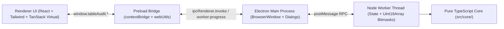

<div align="center">

# TableAudit — Local Data Quality Profiler

**100% офлайн десктопное приложение для системного и бизнес-аналитика: аудит качества табличных данных, профилирование столбцов, сверка выгрузок и генерация SQL DDL.**

[](#установка-запуск-и-сборка)
[](#установка-запуск-и-сборка)
[](#о-проекте-и-ключевые-возможности)
[](#технологический-стек-и-архитектура)
[](#технологический-стек-и-архитектура)
[](#технологический-стек-и-архитектура)
[](#технологический-стек-и-архитектура)
[](#технологический-стек-и-архитектура)
[](#установка-запуск-и-сборка)
[](LICENSE)

[О проекте](#-о-проекте-и-ключевые-возможности) •
[Стек и архитектура](#-технологический-стек-и-архитектура) •
[Установка и запуск](#-установка-запуск-и-сборка) •
[Использование и документация](#-инструкция-по-использованию-и-документация) •
[Лицензия](#-лицензия)

</div>

---

## О проекте и ключевые возможности

**TableAudit** решает ежедневные задачи системного аналитика и инженера данных при работе с «сырыми» выгрузками из CRM, ERP, бухгалтерских систем и партнерских интеграций. Приложение работает **полностью локально без серверов, облачных API и телеметрии**, что делает его безопасным для персональных и финансовых данных.

Тяжелые операции парсинга, профилирования и статистических расчетов вынесены в выделенный **Node.js `Worker Thread`**, а таблица-инспектор использует вертикальную виртуализацию и оконную подгрузку — интерфейс остается отзывчивым на файлах до **100 000 строк**.

### Основные модули

- **Умный импорт и демо-режим (1 клик):**
  - Поддержка `.csv`, `.tsv`, `.xlsx`, `.xls` (с выбором листа) и `.json` (массив объектов с автоматической плоской проекцией вложенных структур через точку).
  - Автоопределение кодировок (`UTF-8` с BOM/без BOM, `Windows-1251`, `KOI8-R`, `UTF-16`) и CSV-разделителей (`,`, `;`, `\t`) с возможностью ручного переключения в верхней панели.
  - Встроенная кнопка **«Загрузить демо-датасет»** — мгновенно загружает 1 000 реалистичных «грязных» заказов со всеми типами аномалий.

- **Дашборд качества данных (`Overview`):**
  - Прозрачный интегральный **Data Quality Score (0–100%)**, рассчитываемый из 4 метрик: **Полнота** (30%), **Уникальность** (25%), **Валидность форматов** (25%), **Согласованность** (20%).
  - Карточки KPI (строки, столбцы, % пропусков, полные дубликаты, всего аномалий, размер файла) и приоритезированный список критических проблем с переходом к проблемным строкам в 1 клик.

- **Профилирование по столбцам (`Column Profiler`):**
  - Автоматическое определение 9 семантических типов: `integer`, `float`, `date`, `datetime`, `email`, `phone`, `boolean`, `categorical`, `string`.
  - Статистики по каждому столбцу: пропуски (`null`, пустые строки, `N/A`, `-`, `н/д`), уникальные значения, `min / max / mean / median`, топ-5 частых значений и интерактивные графики распределения.
  - Автопоиск дефектов: смешанные форматы дат (`2025-04-12` и `12.04.2025`), несуществующие календарные даты (`2025-02-30`), невалидные email, разнобой форматов телефонов, смешанные десятичные разделители (`.` и `,`), числа в виде текста (`15 400 ₽`), лишние/невидимые пробелы (`\u00A0`, `\u200B`) и статистические выбросы по методу межквартильного размаха (**IQR**: ниже $Q_1 - 1.5 \cdot \text{IQR}$ или выше $Q_3 + 1.5 \cdot \text{IQR}$).

- **Инспектор проблем (`Data Grid`):**
  - Виртуализированная таблица (`@tanstack/react-virtual`) с цветовой подсветкой строк-дубликатов и проблемных ячеек.
  - Всплывающие тултипы с точной причиной ошибки при наведении, поиск, выбор столбца и 5 фильтров: *«Все строки»*, *«Только с пропусками»*, *«Только дубликаты»*, *«Только выбросы»*, *«Ошибки формата»*.

- **Сверка двух таблиц (`Reconciliation`):**
  - Загрузка Таблицы B, выбор ключевых полей и столбцов для сравнения.
  - Отчет в 3 секциях: **Только в A**, **Только в B**, **Различия значений** с наглядным diff `было → стало`.

- **Генератор SQL-схемы (`DDL Generator`):**
  - Автоматический `CREATE TABLE` для **PostgreSQL** и **SQLite** (типы `BIGINT`, `NUMERIC(12, 2)`, `DATE`, `TIMESTAMP`, `VARCHAR(N)`, `BOOLEAN` и др., `NOT NULL`, кандидаты `PRIMARY KEY` и `UNIQUE`).
  - Предупреждения прямо в SQL в виде комментариев `-- WARNING:` при наличии дубликатов, `NULL` в ключах или ошибок приведения типов.

- **Безопасная очистка и экспорт отчетов:**
  - Массовые правила очистки без изменения исходного файла: удаление полных дубликатов, обрезка лишних и невидимых пробелов, приведение дат к `ISO 8601 (YYYY-MM-DD)`, унификация десятичных разделителей (`, → .`).
  - Предпросмотр «сколько строк/ячеек изменится» с примерами и экспорт очищенного набора в `.csv` / `.xlsx`, а полного отчета аудита — в автономный `.html` (со стилями) или `.md`.

---

## Технологический стек и архитектура

### Стек технологий (версии из `package.json`)

| Категория | Технология / библиотека | Версия (`package.json`) | Назначение |
| --- | --- | --- | --- |
| Платформа | **Electron** | `^35.0.0` | Кроссплатформенное десктопное приложение (Windows / macOS) |
| Сборка и Dev | **Vite** / **esbuild** / **electron-builder** | `^6.2.0` / `^0.25.0` / `^25.1.8` | Сборка Renderer, бандлинг Main/Preload/Worker и упаковка установщика |
| UI и стили | **React** / **TypeScript** / **Tailwind CSS** | `^18.3.1` / `^5.8.2` / `^3.4.17` | Интерфейс в стиле Linear / DataGrip со светлой и темной темой |
| Виртуализация и графики | **@tanstack/react-virtual** / **Recharts** / **Lucide** | `^3.13.0` / `^2.15.1` / `^0.475.0` | Плавная прокрутка до 100 000 строк, гистограммы, иконки |
| Парсинг и кодировки | **PapaParse** / **SheetJS (`xlsx`)** / **chardet** / **iconv-lite** | `^5.5.2` / `^0.18.5` / `^2.1.0` / `^0.6.3` | Разбор CSV, Excel, JSON и автоопределение `UTF-8` / `Windows-1251` |
| Тестирование | **Vitest** | `^3.0.8` | Unit-тесты чистого ядра анализа (`src/core/`) |

### Архитектура процессов



### Структура проекта

```text
.
├── docs/                          # Проектная документация системного аналитика (RU)
│   ├── architecture.md            # Архитектура, IPC-контракт и Mermaid-диаграммы
│   ├── dq_methodology.md          # Формулы DQ Score, валидация, метод IQR
│   ├── requirements.md            # User Stories с критериями приемки и NFR
│   └── vision_and_scope.md        # Постановка задачи, роли, границы MVP
├── electron/
│   ├── main.ts                    # Main Process, диалоги ОС, управление Worker Thread
│   ├── preload.ts                 # Безопасный contextBridge API (window.tableAudit)
│   └── worker.ts                  # Фоновый процесс: парсинг, профилирование, сверка, экспорт
├── samples/                       # Тестовые «грязные» датасеты для ручной проверки
│   ├── orders_dirty_utf8.csv      # UTF-8, разделитель «;» (300 строк)
│   ├── orders_dirty_cp1251.csv    # Windows-1251, разделитель «,» (250 строк)
│   └── orders_updated_v2.xlsx     # Excel с 2 листами («Заказы» и «Справочник»)
├── scripts/
│   ├── build-all.mjs              # Полная сборка (Vite + esbuild)
│   ├── build-electron.mjs         # Сборка main/preload/worker в dist-electron/*.cjs
│   ├── dev.mjs                    # Параллельный запуск Vite + esbuild watch + Electron
│   └── generate-samples.ts        # Генератор тестовых файлов в samples/
├── src/
│   ├── shared/
│   │   └── types.ts               # Доменные модели и типизированный IPC-контракт
│   ├── core/                      # Независимое чистое TS-ядро анализа
│   │   ├── encoding.ts            # Автоопределение кодировок + iconv-lite
│   │   ├── parser.ts              # Парсеры CSV, XLSX/XLS, JSON (с flattening)
│   │   ├── validators.ts          # Типизация, пропуски, даты, email, телефоны, числа
│   │   ├── statistics.ts          # min/max/mean/median, Q1/Q3/IQR, гистограммы, топ-5
│   │   ├── profiler.ts            # DQ Score, битовые маски строк, Query API для Grid
│   │   ├── reconciler.ts          # Сверка Таблица A vs Таблица B
│   │   ├── ddlGenerator.ts        # Генерация DDL (PostgreSQL / SQLite) с -- WARNING
│   │   ├── cleaner.ts             # Предпросмотр, очистка и экспорт CSV / XLSX
│   │   ├── reportExporter.ts      # Экспорт отчетов в автономный HTML и Markdown
│   │   ├── demoGenerator.ts       # Генератор демо-датасета на 1 000 заказов
│   │   └── __tests__/             # Unit-тесты Vitest (5 файлов, 13 тестов)
│   └── renderer/                  # React-интерфейс (App, components/, views/, utils/)
├── index.html
├── package.json
├── tailwind.config.js
├── tsconfig.json
├── vite.config.ts
└── vitest.config.ts
```

---

## Установка, запуск и сборка

### Требования
- **Node.js** `v18+` (проверено на `v24.14.0`)
- **npm** `v9+`
- **Git**

### Клонирование и установка зависимостей

```bash
git clone https://github.com/Strenchnow/Offline-desktop-Data-Quality-profiler-table-reconciliation-tool-and-SQL-DDL-generator-.git
cd Offline-desktop-Data-Quality-profiler-table-reconciliation-tool-and-SQL-DDL-generator-
npm install
```

### Основные команды (`package.json`)

| Команда | Описание |
| --- | --- |
| `npm run dev` | Запуск в режиме разработки (Vite HMR + автоматическая пересборка Electron + запуск окна) |
| `npm test` | Запуск unit-тестов ядра анализа в **Vitest** (`src/core/__tests__/`) |
| `npm run typecheck` | Проверка типов TypeScript (`tsc --noEmit`) |
| `npm run build` | Production-сборка Renderer (`dist/`) и процессов Electron (`dist-electron/`) |
| `npm start` | Запуск собранного приложения Electron (`electron .`) после `npm run build` |
| `npm run package` | Сборка и упаковка дистрибутива (Windows NSIS/Portable, macOS DMG/ZIP) в `release/` |
| `npm run generate:samples` | Перегенерация тестовых файлов в директории `samples/` |

---

## Инструкция по использованию и документация

### Быстрый старт (демо и тестовые файлы)

1. Запустите приложение (`npm run dev` или `npm run build` → `npm start`).
2. На экране **«Загрузка данных»** нажмите **«Загрузить демо-датасет»** — откроется дашборд **«Обзор качества»** для 1 000 заказов с расчетом DQ Score и списком критических проблем.
3. Нажмите **«К строкам →»** у любой проблемы, чтобы перейти в **«Инспектор данных»** с предустановленным фильтром и наведите курсор на подсвеченную ячейку для просмотра причины ошибки.
4. Для проверки реальных файлов используйте готовые наборы из `samples/`:
   - Откройте `samples/orders_dirty_cp1251.csv` — проверьте автоопределение кодировки `Windows-1251` и кириллицы.
   - Откройте `samples/orders_dirty_utf8.csv`, затем перейдите во вкладку **«Сверка таблиц»** и загрузите `samples/orders_updated_v2.xlsx` (лист `Заказы`) с ключом `order_id`, чтобы увидеть расхождения `было → стало`.
5. Перейдите в **«SQL-схема (DDL)»** для генерации `CREATE TABLE` под PostgreSQL или SQLite и в **«Очистка и экспорт»** для нормализации данных и выгрузки отчета в `.html` / `.md`.

> [!NOTE]
> При открытии нестандартных CSV-выгрузок кодировку (`UTF-8`, `Windows-1251`, `KOI8-R`, `UTF-16LE`), разделитель (`,`, `;`, `\t`) или активный лист Excel можно переключить вручную прямо в верхней панели инструментов без повторного выбора файла.

> [!TIP]
> При работе с таблицами до 100 000 строк полный массив данных хранится только в оперативной памяти фонового `Worker Thread`, а таблица в интерфейсе запрашивает окна по 200 строк по мере прокрутки. Благодаря этому фильтрация по битовым маскам и скроллинг выполняются без задержек.

### Артефакты системного аналитика (`docs/`)

| Документ | Содержание |
| --- | --- |
| [docs/vision_and_scope.md](docs/vision_and_scope.md) | Постановка задачи, проблематика, целевые роли и границы MVP |
| [docs/requirements.md](docs/requirements.md) | Функциональные требования (User Stories + критерии приемки) и NFR |
| [docs/architecture.md](docs/architecture.md) | Архитектура, оптимизация под 100k строк, IPC-контракт, Mermaid-диаграммы (компонентная и Sequence) |
| [docs/dq_methodology.md](docs/dq_methodology.md) | Формулы Data Quality Score, правила вывода типов, метод IQR и правила генерации SQL DDL |

---

## Лицензия

Проект распространяется под лицензией **MIT**. Подробный текст см. в файле [LICENSE](LICENSE).
