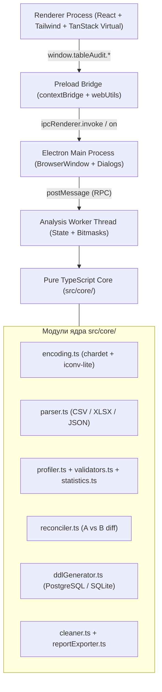
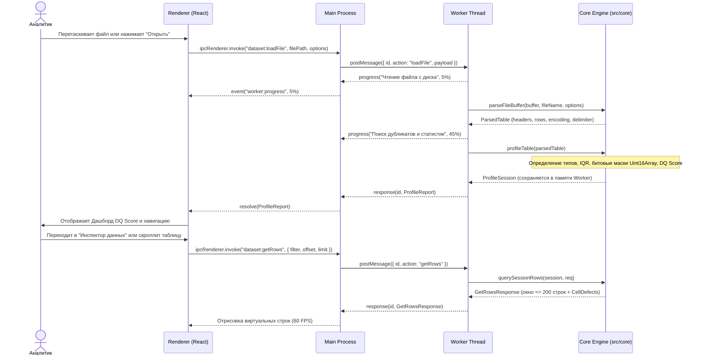

# Архитектура системы — TableAudit

## 1. Обзор архитектуры и технологический стек

Приложение построено по многопроцессной архитектуре **Electron** с жестким разделением ответственности между слоем представления, системным процессом и вычислительным воркером:

- **Renderer Process (React 18 + TypeScript + Tailwind CSS + Recharts + TanStack Virtual):** отвечает исключительно за UI, переключение тем и виртуализированный рендеринг видимой области данных.
- **Preload Bridge (`contextBridge` + `webUtils`):** предоставляет безопасный типизированный API `window.tableAudit`, скрывая прямые вызовы Node.js от браузерного контекста.
- **Main Process (Electron):** управляет жизненным циклом `BrowserWindow`, нативными диалогами выбора/сохранения файлов и проксирует задачи в выделенный `Worker Thread`.
- **Analysis Worker Thread (`worker_threads` + `src/core/`):** хранит распарсенные таблицы A/B и компактные битовые маски строк в оперативной памяти, выполняет парсинг (`papaparse`, `xlsx`, `chardet`, `iconv-lite`), профилирование, расчет IQR, сверку таблиц, генерацию DDL и экспорт файлов.

---

## 2. Компонентная схема

---

## 3. Sequence-диаграмма процесса загрузки и профилирования файла

---

## 4. IPC-контракт и оптимизация под 100 000 строк

Чтобы интерфейс оставался отзывчивым на больших файлах (до 100 000 строк × десятки столбцов):

1. **Единое хранилище в Worker Thread:** полный массив `rows` не пересылается целиком через IPC-сериализацию (Structured Clone). В UI возвращается только легкий `ProfileReport` (сводка, метрики и профили столбцов).
2. **Битовые маски строк (`Uint16Array`):** для каждой строки при профилировании вычисляется 16-битный флаг:
   - `BIT_MISSING = 1`
   - `BIT_DUPLICATE = 2`
   - `BIT_OUTLIER = 4`
   - `BIT_FORMAT_ERROR = 8`
   Это позволяет фильтровать 100 000 строк за 1–3 мс.
3. **Оконный Data Grid + `@tanstack/react-virtual`:** таблица запрашивает страницы по 200 строк (`dataset:getRows`), а дефекты ячеек (`CellDefect[]`) формируются только для видимого окна.

| IPC-канал | Направление | Назначение |
| --- | --- | --- |
| `dialog:openFile` / `dialog:saveFile` | Renderer → Main | Нативные системные диалоги выбора/сохранения |
| `dataset:loadFile` / `dataset:loadBuffer` | Renderer → Worker | Парсинг и профилирование файла |
| `dataset:reparse` | Renderer → Worker | Переразбор при смене кодировки / разделителя / листа |
| `dataset:loadDemo` | Renderer → Worker | Загрузка встроенного демо-датасета (~1 000 строк) |
| `dataset:getRows` | Renderer → Worker | Постраничная выборка строк с фильтрами и тултипами |
| `reconcile:loadSecondFile` / `reconcile:run` | Renderer → Worker | Загрузка Таблицы B и сверка A vs B |
| `ddl:generate` | Renderer → Worker | Генерация `CREATE TABLE` (PostgreSQL / SQLite) |
| `clean:preview` / `export:cleaned` | Renderer → Worker | Предпросмотр очистки и экспорт CSV / XLSX |
| `export:report` / `export:sql` | Renderer → Worker | Экспорт отчета (HTML / Markdown) и `.sql` скрипта |
